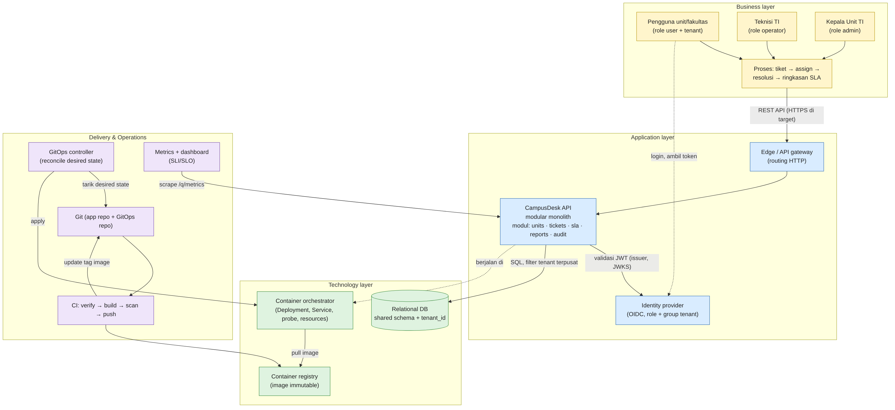
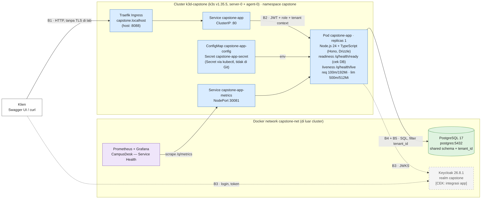
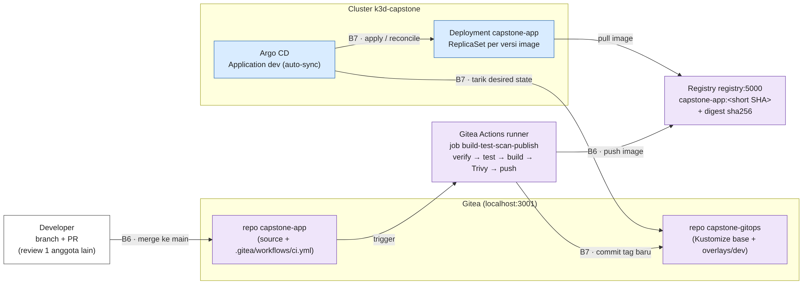
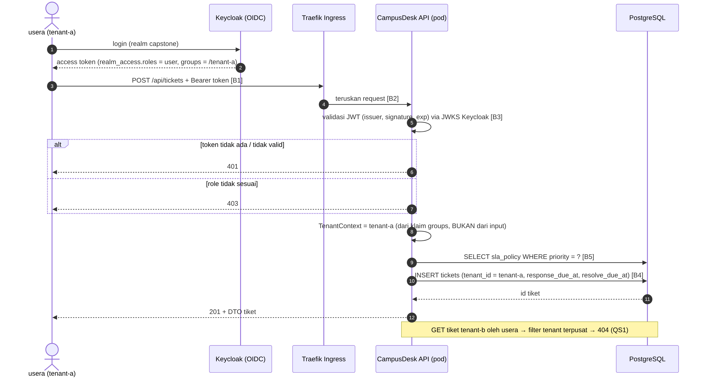
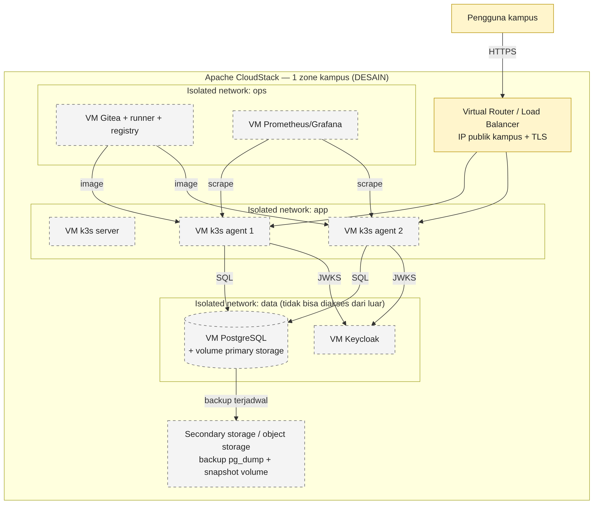

# M1 — Arsitektur CampusDesk

| Field | Isi |
|---|---|
| Scope | Arsitektur CampusDesk: view provider-neutral, pemetaan ke lab (k3d), alur data, dan target CloudStack (desain) |
| Owner | Radya (diagram aplikasi & lab), C (trust boundary & quality scenario); review: B |
| Source / version | Diagram sebagai kode di `diagrams/*.mmd` (Mermaid). Fakta lab diambil dari evidence `04-platform-kubernetes` (10 Nov 2026), `05-ci-cd-gitops` (run #4, image `d35da363e4c2`), dan `07-observability-slo` |
| Timestamp | 17 Nov 2026 (v0.1) |
| Status | Draf, direview tim sebelum dikunci |

> Label status komponen: **✅ berjalan** (ada evidence) · **🟡 sebagian** · **⬜ rencana** · **[CEK]** perlu dibuktikan.

Dokumen terkait: [`boundaries.md`](boundaries.md) (trust & failure boundary), [`quality-scenarios.md`](quality-scenarios.md) (QS1–QS7), ADR di `../10-decisions-adr/`.

---

## 1. Ringkasan arsitektur

CampusDesk adalah **modular monolith** (satu deployable, beberapa modul: `units`, `tickets`, `sla`, `reports`, `audit`) yang melayani banyak unit kampus sebagai **tenant** dalam **satu database dengan shared schema + kolom `tenant_id`**. Identitas dan role berasal dari **identity provider OIDC**. Tenant diambil dari klaim `groups` di token, tidak pernah dari input request.

Aplikasi dijalankan sebagai container di Kubernetes. Perubahan masuk lewat **CI → image immutable → repo GitOps → GitOps controller**, sehingga CI tidak pernah menyentuh cluster secara langsung.

| Keputusan utama | Alasan singkat | ADR |
|---|---|---|
| Modular monolith, bukan microservices | Domain kecil (5 entitas); fokus kursus pada operasi cloud, bukan distribusi service | ADR-001 |
| Shared schema + `tenant_id` | Murah dan sederhana untuk banyak tenant kecil; isolasi ditegakkan aplikasi dan diuji negatif | ADR-002 |
| Tenant dari klaim `groups` OIDC | Pengguna tidak bisa memalsukan tenant lewat body/header | ADR-003 |
| Tenggat SLA disimpan saat tiket dibuat | Perubahan kebijakan SLA tidak mengubah tiket lama; breach dihitung lewat query (aman untuk >1 replika) | ADR-005 |
| PostgreSQL di luar cluster | Mengikuti paket lab; data tidak ikut hilang saat cluster dibuat ulang | ADR-008 |
| GitOps, build once → promote | Satu image yang sama berpindah antar environment; rollback = `git revert` | ADR-007 |
| Node.js + TypeScript menggantikan Quarkus | Substitusi dari jalur referensi kursus; kapabilitas wajib tetap terpenuhi | ADR-014 |

## 2. View 1 — Provider-neutral

Tidak menyebut produk tertentu. Lapisan mengikuti gaya ArchiMate (Business → Application → Technology), ditambah lapisan Delivery & Operations.

| Komponen logis | Tanggung jawab | Contoh implementasi |
|---|---|---|
| Edge / API gateway | Titik masuk HTTP, routing berdasarkan host | Traefik Ingress (lab), load balancer CloudStack (target) |
| CampusDesk API | Workflow tiket, SLA, laporan, audit, filter tenant | Node.js 24 + TypeScript (Hono, Drizzle) |
| Identity provider | Login, penerbitan token, role, grup tenant | Keycloak |
| Relational DB | Data persisten semua tenant | PostgreSQL 17 |
| Container orchestrator | Menjalankan, memulihkan, dan mengekspos workload | k3s (k3d di lab) |
| Container registry | Menyimpan image immutable | Registry lokal |
| CI | Verify, test, build, scan, push | Gitea Actions + Trivy |
| GitOps controller | Menyamakan cluster dengan desired state di Git | Argo CD |
| Metrics + dashboard | SLI/SLO untuk Kepala Unit TI | Prometheus + Grafana |

## 3. View 2 — Implementasi lab

Semua komponen berjalan di **satu laptop** (Docker Desktop, Windows). Cluster k3d berisi 2 node (container `server-0` dan `agent-0`). PostgreSQL, Keycloak, Gitea, registry, dan Prometheus/Grafana berjalan sebagai container di Docker network `capstone-net`, di luar cluster.

### 3a. Jalur runtime (trust boundary B1–B5)

### 3b. Jalur delivery (trust boundary B6–B7)

### 3c. Status komponen lab

| Komponen | Detail | Status | Bukti |
|---|---|---|---|
| Cluster k3d-capstone | k3s v1.35.5+k3s1, 2 node Ready | ✅ | `04-platform-kubernetes/04_evidence.jpg` |
| Deployment `capstone-app` | replicas 1, image `registry:5000/student/capstone-app:<short SHA>` | ✅ | idem (image `d35da363e4c2`, 3 ReplicaSet histori) |
| Probe | readiness `/q/health/ready` (termasuk cek DB), liveness `/q/health/live` | ✅ | idem (`{"status":"UP","checks":[{"name":"database","status":"UP"}]}`) |
| Resources | requests 100m / 192Mi, limits 500m / 512Mi | ✅ | idem |
| Service + Ingress | ClusterIP :80, Traefik host `capstone.localhost` (host port 8088) | ✅ | idem + Swagger `03_evidence.jpg` |
| Service metrics | NodePort 30081 → `/q/metrics` | ✅ | idem |
| ConfigMap + Secret | Secret dibuat via `kubectl`, tidak di Git | ✅ | `describe deployment` (env from ConfigMap/Secret) [CEK: screenshot] |
| PostgreSQL 17 | `postgres:5432` di `capstone-net` | ✅ | health check `database: UP` |
| CI Gitea Actions | `build-test-scan-publish`: verify → test → build → Trivy → push → update GitOps | ✅ | `05-ci-cd-gitops/05_evidence.jpg` (run #4, digest `sha256:ce653b…`) |
| Repo GitOps + Argo CD | CI commit tag ke `overlays/dev` (`c8162ce → 6f24740`); Argo CD auto-sync dev | ✅ | idem [CEK: screenshot status Synced/Healthy] |
| Prometheus + Grafana | dasbor *CampusDesk — Service Health* | ✅ | `07-observability-slo/07_evidence.jpg` |
| Keycloak + OIDC di aplikasi | realm `capstone`, mapper `groups`, validasi JWT di app | 🟡 / [CEK] | `/api/units` di evidence 10 Nov masih publik |
| staging / prod | overlay + namespace + DB terpisah | ⬜ | rencana M4 (ADR-011) |

## 4. View 3 — Alur data utama (membuat tiket)

Poin yang perlu bisa dijelaskan saat defense:

1. Validasi token dan role terjadi **di backend**, bukan di UI, jadi request langsung dengan `curl` tetap ditolak (401/403).
2. `TenantContext` dibentuk **sekali per request** dari klaim `groups`, lalu dipakai oleh semua query tiket di **satu tempat terpusat**.
3. Tenggat SLA (`response_due_at`, `resolve_due_at`) dihitung saat tiket dibuat dari tabel `sla_policy`.
4. Akses tiket tenant lain oleh `user` → **404**, supaya keberadaan tiket tidak bocor (QS1).

## 5. View 4 — Target private cloud CloudStack (DESAIN)

> Bagian ini **desain dan roadmap**, belum diimplementasikan.

| Lab (sekarang) | Target CloudStack | Yang berubah |
|---|---|---|
| k3d (node = container di satu laptop) | VM k3s server + ≥ 2 VM agent | Kegagalan satu host tidak lagi mematikan semua node |
| Traefik via `localhost:8088`, HTTP | Virtual Router / LB dengan IP publik kampus + TLS | B1 terenkripsi |
| PostgreSQL container | VM PostgreSQL di isolated network data, volume primary storage | Data tidak bisa diakses langsung dari luar |
| Backup ke disk laptop | Backup terjadwal ke secondary/object storage + snapshot volume | RPO bisa ditetapkan dan diuji |
| Gitea, registry, monitoring di laptop | VM terpisah di network ops | Delivery tidak bergantung pada laptop anggota |

Yang **tetap sama**: image, manifest Kustomize, repo GitOps, dan Argo CD. Ini alasan arsitekturnya disebut provider-neutral.

## 6. Asumsi dan keterbatasan

- Single laptop, single DB, `replicas: 1` → **tidak ada klaim HA atau DR**.
- dev/staging/prod direncanakan sebagai namespace + database terpisah dalam **satu cluster dan satu server PostgreSQL** (pemisahan logis, bukan fisik).
- Lalu lintas lab memakai HTTP tanpa TLS.
- Integrasi OIDC dan tenant filter masih dikerjakan di M2; diagram 3 menggambarkan target M2, bukan kondisi 10 Nov.
